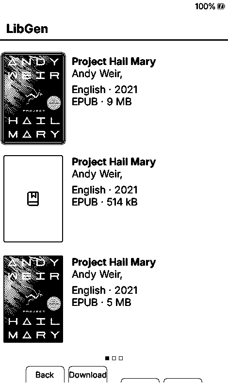

# CrossCover

CrossCover is a personal firmware fork based on [CrossInk](https://github.com/uxjulia/CrossInk) for the Xteink X3 and X4.

CrossCover adds Hardcover integration and a LibGen client
while retaining the CrossInk reader foundation.

- Current release: `1.6.1-crosscover.1`
- Next release, prepared on `main`: `1.6.1-crosscover.2`
- Based on CrossInk: `1.6.1`

## Screenshots

<p align="center">
  
  
  
</p>

## ⚠️ Important hardware warning

CrossCover is intended for the Xteink X3 and X4.

Do not flash CrossCover on:

- Any device other than an Xteink X3 or X4
- A USB-locked Xteink device

## CrossCover additions

### Hardcover integration

- Set up an API key through the local web portal or import it from the SD card
- Link an EPUB automatically or by Hardcover Book ID or ISBN, then review its account state and edition before confirming
- Choose Want to read, Reading, Read, Paused, or Did not finish from one status selector
- Rate books from 0.5 to 5.0 stars in half-star steps
- Prepare status, progress, and rating changes offline, including before linking a book
- Review queued changes and discard them individually or together
- Send only the current book's changes from its reader menu, or process the queue from Hardcover Library
- Browse Hardcover Library ten books at a time and view book details

Hardcover actions are user-triggered. CrossCover does not run a background sync task or send page-by-page API updates.

The in-book menu shows state saved on the device, including pending changes; it does not fetch live account data every time it opens. Current reading progress and queued progress are shown separately. Sending from a book saves its reading position and restarts into a minimal network session to release reader memory before connecting. Back from the result screen returns to the book.

### LibGen integration

- Open LibGen from `Home → CrossCover → LibGen`
- Search books directly from the device
- Display the title, author, year, language, format, file size, and cover when available
- Return up to 8 EPUB matches from the first 25 LibGen catalog entries
- Download books directly to the SD card
- Keep the search text when starting another search, and retry a failed search or download without starting over
- View the saved file path after downloading and choose Open to start reading
- Reopen the last completed download from the same results without downloading another copy
- Choose the download folder from `Settings → System → LibGen Download Folder`
- Use a lightweight relay so the device receives only compact search results

Search and downloads use the CrossCover Worker relay and LibGen's `ads.php` → `get.php` download chain. Use the feature only for books you are legally allowed to access or download.

## Hardcover setup

1. Create a Hardcover API key.
2. Create this file on the SD card:

   ```text
   /.crosspoint/hardcover_token.txt
   ```

3. Put only the API key in the file.
4. Insert the SD card and boot the device.
5. Open:

   ```text
   Settings → System → Hardcover → Import API Key
   ```

6. Choose `Check connection` and connect to Wi-Fi. A successful check shows `Hardcover is ready`.

Alternatively, open the device's local web portal, go to its Settings page, and save the key in the Hardcover section. Then return to the device and choose `Check connection` in Hardcover settings. Account removal clears the saved key while retaining book links and queued changes.

## Linking a book to Hardcover

Inside an EPUB, open the reader menu's bookmark-icon tab (`Location`) and choose `Hardcover`, immediately after `Sync Progress` on X3/X4.

1. Use `Status`, `Queue current <percent>%`, and `Rate` to prepare the changes you want to send. Ratings use half-star steps. These actions save changes locally.
2. Choose `Link book`, then `Find and link online` or `Hardcover Book ID or ISBN`. For an already linked book, open `Linked book` to change the link.
3. Review the matching title, author, existing status, progress, rating, and edition. Confirm links the book and sends its queued changes; Back returns to the candidates.
4. For later changes, choose `Send changes` when connected or ready to connect. This action appears when the book has pending changes. `Review queued changes` lets you discard selected changes before sending.
5. Check the completed and pending counts on the result screen. Use Retry if changes remain after a failure, or Back to return to reading.

Automatic matching searches using the EPUB title and author. Check the selected book and edition before confirming. Progress uses the linked reading edition's page count; a missing edition page count prevents a page-based progress update rather than guessing from another edition. Choosing Read does not automatically force progress to 100%.

For the account library and its pending updates, open `Home → CrossCover → Hardcover Library`.

## Windows simulator

Run `simulator.cmd` from the project directory to test the firmware UI in a desktop window. The first run downloads the portable tools and builds the simulator; later runs open the existing build. Git and PlatformIO's Python environment are required.

- Put test EPUBs in `fs_/books`; this virtual SD card is separate from the reader's SD card.
- Close the window and run `simulator.cmd --build` after code changes.
- Press F12 to save screenshots in `.cache/windows-simulator/screenshots`.

See [the simulator guide](docs/simulator.md) for controls and other platforms. The simulator checks layout and navigation; device RAM, TLS, and physical e-ink behavior still need hardware testing.

## Functionality inherited from CrossInk

The following functionality comes from the [CrossInk](https://github.com/uxjulia/CrossInk):

- EPUB reading support
- Chapter navigation
- Footnotes
- Bookmarks and clippings
- Reading statistics
- Custom fonts
- Reader layout and typography settings
- Offline dictionary lookup and dictionary management
- Auto page turn
- WiFi and file-transfer functionality
- Themes
- Firmware update and device-management functionality
- Other reader, storage, and system functionality provided by CrossInk

For the complete upstream feature list and documentation, see the [CrossInk repository](https://github.com/uxjulia/CrossInk).

## Flashing

Official CrossCover releases contain only the hardware-tested `firmware-x3-x4` image. Only flash it on a supported, non-USB-locked Xteink X3 or X4.

CrossInk's source environments for Sticky, X4 Pro, and X4 Classic remain available, but the CrossCover maintainer does not own those devices and cannot validate or support their builds. Advanced users may [build those targets from source](docs/development/unsupported-target-builds.md) at their own risk.

Before flashing, verify:

- The device is definitely an Xteink X3 or X4.
- The device is not USB-locked.
- The firmware file matches the intended build.
- Important SD-card files are backed up.

## Versioning

CrossCover follows the upstream CrossInk version and adds a fork-specific suffix.

Example:

```text
1.6.1-crosscover.1
```

This means CrossCover release `1` based on CrossInk `1.6.1`.

Another CrossCover release based on the same CrossInk version would increment the suffix:

```text
1.6.1-crosscover.2
```

CrossCover is an independent personal fork and is not an official CrossInk release.

## Known limitations

- Xteink X3 and X4 only
- USB-locked devices must not be flashed with CrossCover
- Automatic Hardcover matching can select an incorrect book
- In-book Hardcover data is cached locally; changes made on the website are not fetched automatically when opening the menu
- Hardcover progress requires a known page count for the selected edition; separate reading-session history is not managed by CrossCover
- IPA symbols may use readable approximations when the required glyph is not available in the firmware font
- LibGen search and downloads depend on the availability of the LibGen catalog and its file mirrors
- The current search flow is limited to EPUB results
- Downloads may fail when all upstream mirrors are unavailable

## Credits

CrossCover is based on the [CrossInk](https://github.com/uxjulia/CrossInk) firmware project.

The Hardcover integration was informed by the Hardcover API documentation, KOReader Hardcover integration, and NickelHardcover.

CrossCover is developed independently and is not an official CrossInk project.

AI assistance was used during development for code inspection, API debugging, feature design, and documentation.

## Support

If you find a CrossCover-specific bug or have a feature request, open an issue in this repository.

For functionality inherited from CrossInk, consult the upstream [CrossInk repository](https://github.com/uxjulia/CrossInk).

If you would like to support development:

[](https://ko-fi.com/E3M5210X5J)
